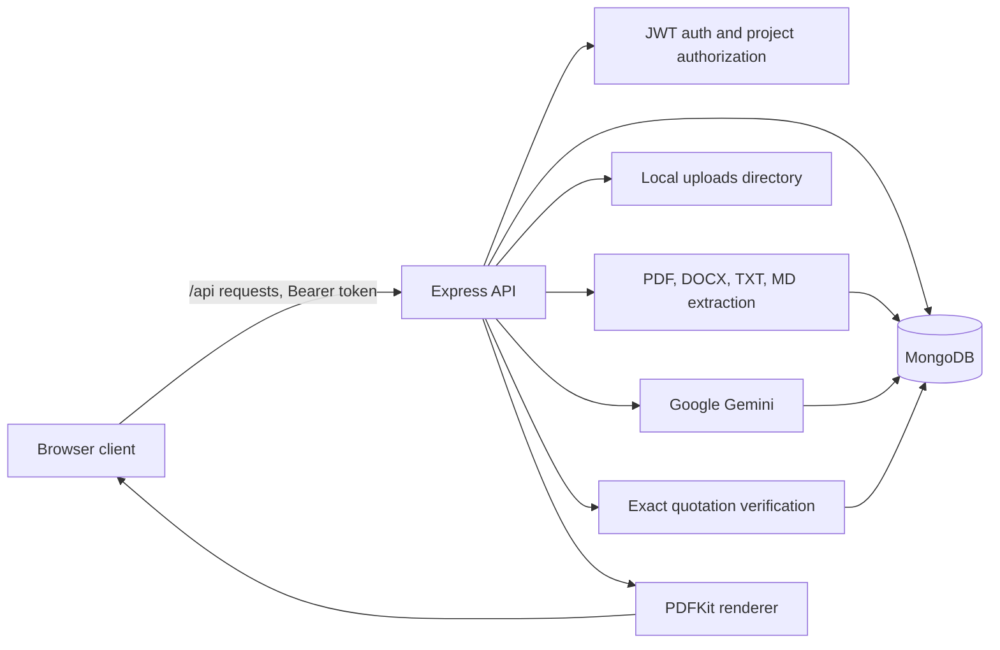
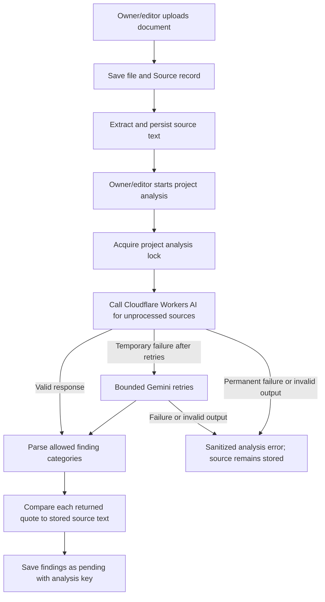
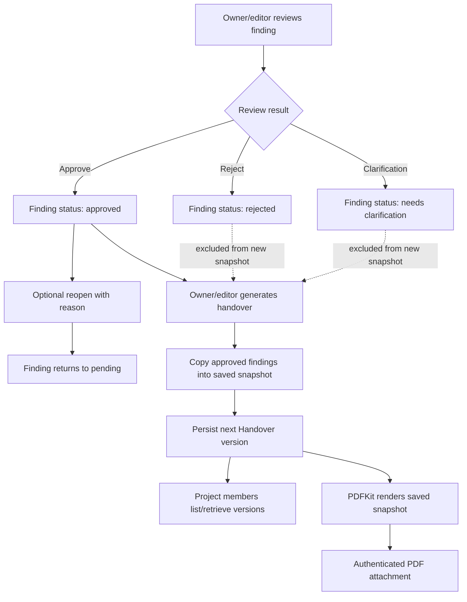
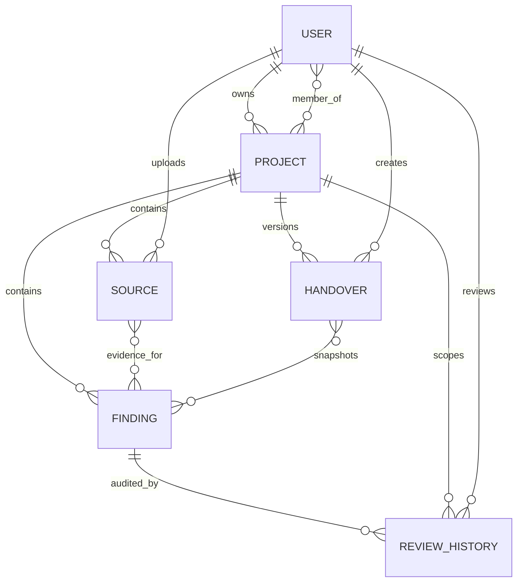

# RELAY Architecture

> **When someone leaves, their knowledge doesn't.**

## Purpose

RELAY turns project documents into candidate handover findings, lets authorized teammates verify and review those findings, and saves versioned reports so project knowledge can be transferred. Cloudflare Workers AI is the primary finding proposer and Gemini is the secondary provider; strict schema and evidence checks precede saving. People review findings and confirmed contradiction candidates, and assigned approvers sign exact handover versions.

## System overview

## Round 3 delivery

The current implementation includes GitHub App authorization and manual bounded ingestion (README, up to 50 commits and up to 100 qualifying issues), immutable `SourceRevision` provenance, explicit revision-pinned analysis, human-reviewed contradiction candidates, project reviewer/approver assignments, immutable version-specific handover signoff, and tombstone-based project deletion/recovery. The internal cleanup endpoint is authenticated by `CRON_SECRET` and scheduled by the backend Vercel configuration. These implementation claims do not verify production credentials, database migrations/indexes, registered Vercel cron, or browser end-to-end behavior.

The browser client sends authenticated requests to an Express API. The API checks JWT identity and project membership, stores project/workflow records and immutable source revisions in MongoDB, and stores uploaded originals in configured private storage. It retrieves bounded GitHub repository context through a GitHub App, runs explicit revision-pinned AI analysis, and renders versioned handover snapshots with PDFKit.

The diagram shows logical components, not separate deployed services. Extraction, Gemini calls, verification, and PDF rendering run in the Node.js backend process.

## Frontend

The Vite application is implemented primarily in `client/index.html` and `client/src/main.js`; `client/vite.config.js` configures the local development server and `/api` proxy. The client manages authentication state, selected project state, navigation, forms and modals, loading/error/empty states, and rendering of projects, sources, findings, review history, membership, and handovers. API calls use the selected project’s MongoDB ObjectId and send the bearer token.

The browser stores the JWT in local storage. The demo workspace is separate illustrative client-side data; demo findings are not Gemini output and demo actions do not write to the real project API.

## Backend

`server/server.js` loads environment configuration, connects Mongoose when `MONGODB_URI` is configured, and starts Express. `server/src/app.js` configures Helmet, CORS, JSON parsing, rate limiting, health handling, route mounting, and sanitized error responses.

Backend responsibilities are divided across:

- `server/src/routes/` — authentication, projects and membership, sources, findings and review, and handovers.
- `server/src/middleware/` — bearer-token authentication and project access/editor/owner checks.
- `server/src/models/` — Mongoose schemas and references.
- `server/src/services/` — project permissions/membership, document extraction, Gemini analysis, evidence verification, review transitions, and handover snapshots/PDF rendering.
- `server/src/utils/safeLogger.js` — structured error logging with text redaction.

## Authentication and session flow

1. Registration validates name, email, and password, stores a bcrypt password hash, then returns a JWT and public user object. Login verifies the password hash and returns the same response shape.
2. The JWT contains the user ID in its `sub` claim and expires after 12 hours.
3. The client stores the token in browser local storage and sends `Authorization: Bearer <token>` for authenticated requests.
4. `requireAuth` verifies the JWT, looks up the user without `passwordHash`, and attaches that user to the request. The client restores a saved session using `GET /api/auth/me`.

This is stateless token authentication, not a server-side session or cookie flow. Logging out removes the client token; it does not revoke an already issued JWT server-side.

## Project membership and authorization

The `Project.owner` field is authoritative for the owner. The `Project.members` array stores user references and `editor` or `viewer` roles. The owner remains an owner even if also represented in the member array. Existing projects remain accessible through their owner field; membership is not public by default.

| Capability | Owner | Editor | Viewer |
| --- | --- | --- | --- |
| Read project, sources, findings, evidence, review history, and handovers | Yes | Yes | Yes |
| Update project, upload/delete sources, run analysis | Yes | Yes | No |
| Edit, approve, reject, clarify, or reopen findings | Yes | Yes | No |
| Add, change, or remove project members | Yes | No | No |
| Delete project | Yes | No | No |

Membership management only adds an existing registered account by email. There is no email invitation flow or ownership transfer endpoint. Route middleware and permission helpers enforce access on the backend; hiding a frontend control is not the authorization boundary.

## Document upload and extraction

An authenticated owner or editor uploads one file as multipart field `file` to the selected project’s sources endpoint. The server accepts `.pdf`, `.docx`, `.txt`, and `.md` up to 15 MiB (15 × 1024 × 1024 bytes). It writes the uploaded file under the server process’s `uploads` directory, creates a `Source` record, extracts text using `pdf-parse`, Mammoth, or UTF-8 reading, then saves the extracted text and processing status in MongoDB. If extraction fails, the source is marked failed and the request returns an error; the error path does not automatically delete the uploaded file.

Source listing omits extracted text and storage paths. Authorized project members can request extracted text or download the original file. Local disk storage means deployments need persistent private storage if server disks are ephemeral or requests can reach multiple instances.

## AI analysis and finding generation

An owner or editor starts analysis for a project. The API selects processed sources that have not already been analyzed, takes a project-level lock, and processes sources with limited concurrency. Cloudflare Workers AI (`@cf/openai/gpt-oss-20b`) is primary. It receives at most the first 45,000 characters of each source’s extracted text, requests structured findings in the supported categories, uses a 30-second timeout, and retries recognized temporary failures with bounded backoff. On exhausted temporary HTTP 408, 429, 500, 502, 503, or 504 failures, recognized network failures, or timeouts, the service makes bounded retries to Gemini. Cloudflare or Gemini authentication/configuration errors, input errors, and malformed or unsupported output do not trigger another provider fallback. Attempt records identify each provider as primary or secondary.

Cloudflare output must match the finding contract, and every Cloudflare quote must verify against the original extracted text before it is accepted; its section/page metadata is omitted because it is not independently verified. Gemini responses retain their existing quote-verification behavior. Malformed fallback data or unsupported quotes produce a sanitized error and no findings for that source. Accepted findings remain pending. Provider diagnostics record provider, request start/completion, duration, and fallback state only; they do not log prompts, extracted text, credentials, or signed URLs. A source analysis marker and finding writes are protected by a MongoDB transaction and stable analysis keys/legacy lookup to prevent duplicate findings on retry. A provider failure does not delete the uploaded source. Provider availability, quota, output quality, and model access depend on configuration and provider accounts.

## Evidence verification

The evidence verifier compares each model-provided quote against the original extracted text. Matching normalizes harmless formatting differences such as Markdown list markers and whitespace, while preserving offsets back to the original text. When a match is established, evidence stores `verificationStatus: verified`, the exact original matched passage, and start/end offsets. The original model quote is retained. Paraphrases, absent quotes, and unsupported text remain unverified. Old findings without verification metadata are treated as unverified.

Human approval is an independent review decision. Approving a finding does not cause its evidence to become verified. The UI and generated report retain this distinction.

## Human review lifecycle and audit history

Review actions are available to owners and editors. Findings normally begin `pending` and can be approved, rejected with a required reason, or moved to `needs_clarification` with a required comment. Editable fields are title, description, and category. Editing a clarification-needed finding returns it to pending. An approved finding can be reopened with a required reason; reopening returns it to pending so it must be reviewed again. Invalid transitions are rejected by the review service.

Each review action updates the finding and creates a `ReviewHistory` record in the same MongoDB transaction. History records reference the finding, project, and reviewer, and include action, timestamp (Mongoose timestamps), and prior/updated values and reason/comment where applicable. A project member can retrieve a finding’s history. MongoDB transactions require a transaction-capable deployment (such as Atlas or a replica set); standalone MongoDB deployments may not support this workflow.

## Handover snapshots, version history, and PDF download

An owner or editor generates a handover. The API snapshots currently approved findings and human-confirmed contradiction candidates, allocates a version, and stores immutable report content and finding IDs in a `Handover` document. Newly generated versions are `pending` when assigned signoff is enabled and `draft` for legacy projects with signoff disabled. Later review actions do not rewrite a snapshot. In assigned mode, an active assigned approver other than the creator may record one decision against that exact version; approval marks it approved, while rejection is terminal and requires a reason. A newer version does not inherit decisions, and a pending older version is computed as superseded and cannot be signed. `POST /api/handovers/:handoverId/signoffs` records the decision and `GET` on the same path returns its history.

Project members can list versions or retrieve an individual handover. The PDF download route reads the saved snapshot, renders it with PDFKit, and returns `application/pdf` as an attachment. It does not rerun Gemini or regenerate the snapshot from current findings.

## MongoDB models and relationships

| Model | Main data and relationships |
| --- | --- |
| `User` | Name, normalized unique email, password hash, timestamps. Password hash is excluded from authenticated user lookup responses. |
| `Project` | Name, description, owner reference, member references and roles, status, analysis/handover locks, timestamps. |
| `Source` | Project and uploader references, original filename, MIME type, size, local storage path, extracted text, processing status, analysis marker, timestamps. |
| `Finding` | Project reference, category, title, description, confidence, evidence entries, review status, reviewer metadata, timestamps. Evidence can reference a source and stores original quote plus verification metadata. |
| `ReviewHistory` | Finding, project, reviewer references; action; prior/updated values; optional reason/comment; timestamps. |
| `Handover` | Project and creator references, version, immutable report-content snapshot, included finding IDs, approval status, timestamps. |

The diagram shows conceptual references; some relationships are stored as ObjectIds in arrays or nested evidence entries rather than separate join collections.

## Security considerations and current limitations

- API routes require bearer authentication except `GET /api/health`; project data is additionally protected by membership/role checks.
- `JWT_SECRET`, `MONGODB_URI`, `GEMINI_API_KEY`, `CLOUDFLARE_ACCOUNT_ID`, and `CLOUDFLARE_API_TOKEN` are server configuration and must not be exposed to the browser.
- Express uses Helmet, configured CORS, a 2 MB JSON body limit, and a global rate limit of 300 requests per 15 minutes. Error responses hide internal details for 5xx errors; structured logs redact common credential patterns.
- Local file storage requires private durable storage and retention controls for production.
- Browser tokens are stored in local storage; the app does not use HttpOnly session cookies.
- Gemini can fail due to provider availability, quota, model configuration, or response parsing. Analysis is not guaranteed to succeed.
- The demo workspace is illustrative, not persisted analysis. Profile editing, password recovery, notifications, archive export, and a general-purpose audit timeline UI remain unavailable. Formal version-specific signoff and project deletion/recovery are implemented.
- This document describes inspected code paths; it does not certify a deployed environment, live database, or provider availability.
